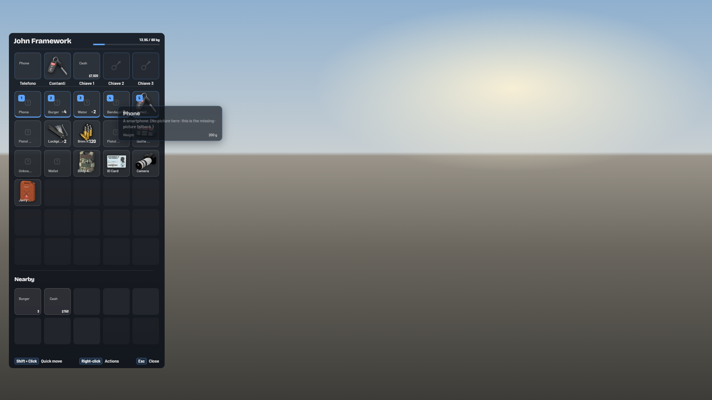
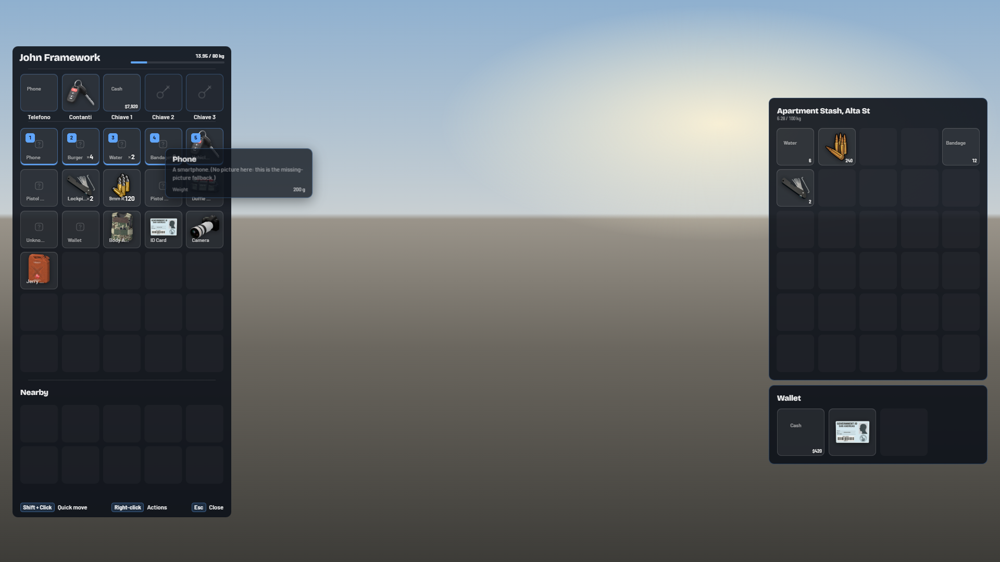

# whip_inventory_compact — "Zwei gleich breite Spalten"

Ein Skin für WHIPs Inventar. Er **ersetzt den Renderer nicht**: `whip_core` zeichnet weiterhin
Slots, Drag & Drop, Tooltips, Menüs, Gewichte und die serverseitige Validierung. Diese Ressource
fügt nur ein `theme.css`, ein kleines `client.lua` gegen den Spiel-Blur und einen
Sprachumschalter mit einer Zeile hinzu.

Die vollständige italienische Dokumentation und alle Prüfungen stehen in [README.md](README.md).

## Funktionen

- Zwei gleich breite Spalten à 420px bei 1080p, 24px Rand, freie Bildschirmmitte.
- Links: angehängter Titel, 5 native Zubehör-Slots, Spielergrid, Nearby und Tastenhinweise.
- Rechts: Taschen, Kofferraum und Geldbeutel vertikal gestapelt, nie überlappend.
- 5 Spalten pro Grid, 72px Slots, kein Blur und kein Abdunkeln.
- Animiertes Öffnen/Schließen, animiertes Einblenden von Panels, verzögertes Tooltip, das niemals
  den Bildschirm verlässt.
- Die Tab-Schnellleiste nutzt denselben Stil und bleibt nach dem Loslassen 2 Sekunden sichtbar.

## Sprachen (IT / EN / ES / FR / DE)

Ändere eine Zeile in `config.lua` und führe `restart whip_inventory_compact` aus:

```lua
Config.Locale = 'de' -- it, en, es, fr, de
```

`server.lua` kompiliert die gewählten Beschriftungen nach `locales/active.css`, was `theme.css`
importiert. Der Fallback ist `en` → `it` → Schlüsselname, genau wie bei `whip_clothingwheel`.
Übersetzt werden nur die 5 Zubehör-Beschriftungen und die Konsolenmeldungen dieser Ressource:
alle anderen Inventartexte gehören zu `whip_core` und lassen sich per CSS-Theme nicht ändern.

## Installation

Den Ordner nach `resources/[custom]/whip_inventory_compact/` kopieren und
`ensure whip_inventory_compact` in die `server.cfg` schreiben oder über txAdmin starten.
`whip_core` wird benötigt. Bestehende Serverdateien müssen nicht bearbeitet werden.

| Befehl | Wirkung |
|---|---|
| `restart whip_inventory_compact` | CSS neu laden, Sprache neu erzeugen, Skin für alle anwenden |
| `stop whip_inventory_compact` | WHIPs Originalaussehen wiederherstellen |
| `/whip_theme whip_inventory_compact` | CSS nur für dich erneut anwenden (braucht `whip.devtools`) |

## GitHub-Paket

MIT-`LICENSE`, `.gitignore`, `CHANGELOG.md` und Screenshots in `docs/screenshots/`. Version `1.2.0`.
Veröffentlicht unter https://github.com/OkanFeNwa/whip_inventory_compact (Branch `main`); das Manifest enthält bereits das Feld `repository`.




