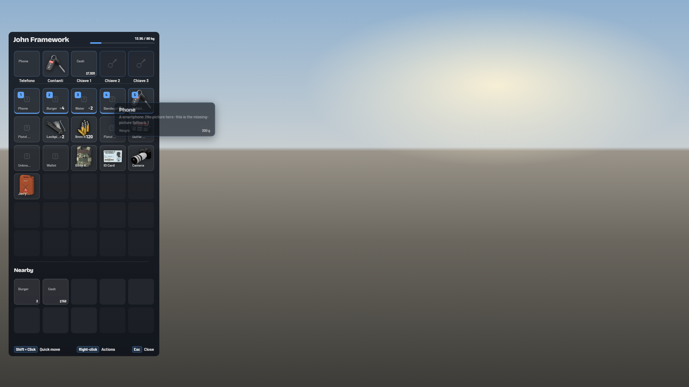
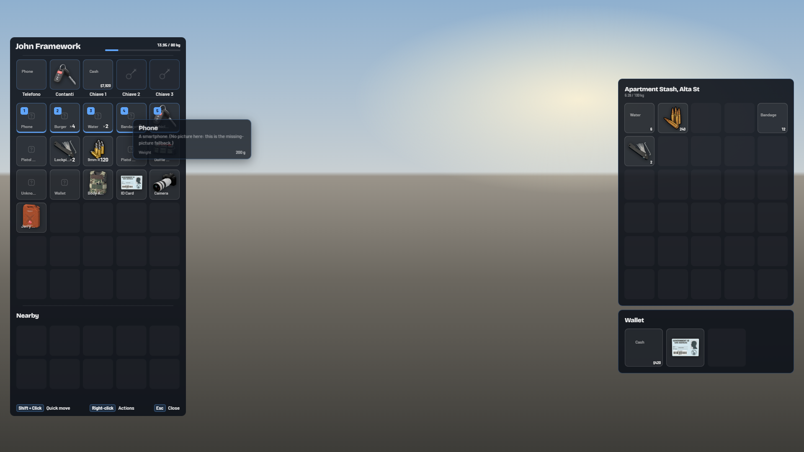

# whip_inventory_compact — "Tall Twin Columns"

A skin for WHIP's inventory. It **does not replace the renderer**: `whip_core` still draws every
slot, drag & drop, tooltip, menu, weight and server-side validation. This resource only adds a
`theme.css`, a small `client.lua` that cancels the game blur, and a one-line language switch.

See [README.md](README.md) for the full Italian documentation and verification notes.

## Features

- Two equal 420px columns at 1080p, 24px screen gutter, centre of the screen free.
- Left: attached title, 5 native accessory slots, player grid, Nearby, key hints.
- Right: bags / trunk / wallet panels stacked vertically, never overlapping.
- 5 columns per grid, 72px screen slots, no blur and no screen dimming.
- Animated open/close, animated panel arrival, delayed item tooltip that never leaves the screen.
- Tab hotbar matches the inventory and stays fully visible for 2 seconds after release.

## Languages (IT / EN / ES / FR / DE)

Change one line in `config.lua`, then run `restart whip_inventory_compact`:

```lua
Config.Locale = 'en' -- it, en, es, fr, de
```

`server.lua` compiles the selected labels into `locales/active.css`, which `theme.css` imports.
Fallback is `en` → `it` → key name, exactly like `whip_clothingwheel`. Only the five accessory
labels and this resource's console messages are translated: the other inventory strings belong to
`whip_core` and cannot be changed by a CSS theme.

## Install

Copy the folder to `resources/[custom]/whip_inventory_compact/` and add
`ensure whip_inventory_compact` to `server.cfg`, or start it from txAdmin. `whip_core` is required.
No existing server file needs to be edited.

| Command | Effect |
|---|---|
| `restart whip_inventory_compact` | reload CSS, regenerate the language file, reskin everyone |
| `stop whip_inventory_compact` | restore WHIP's stock look |
| `/whip_theme whip_inventory_compact` | reapply the CSS for you only (needs `whip.devtools`) |

## GitHub package

MIT `LICENSE`, `.gitignore`, `CHANGELOG.md`, screenshots in `docs/screenshots/`. Version `1.2.0`.
Add your repository URL to `fxmanifest.lua` before publishing.




