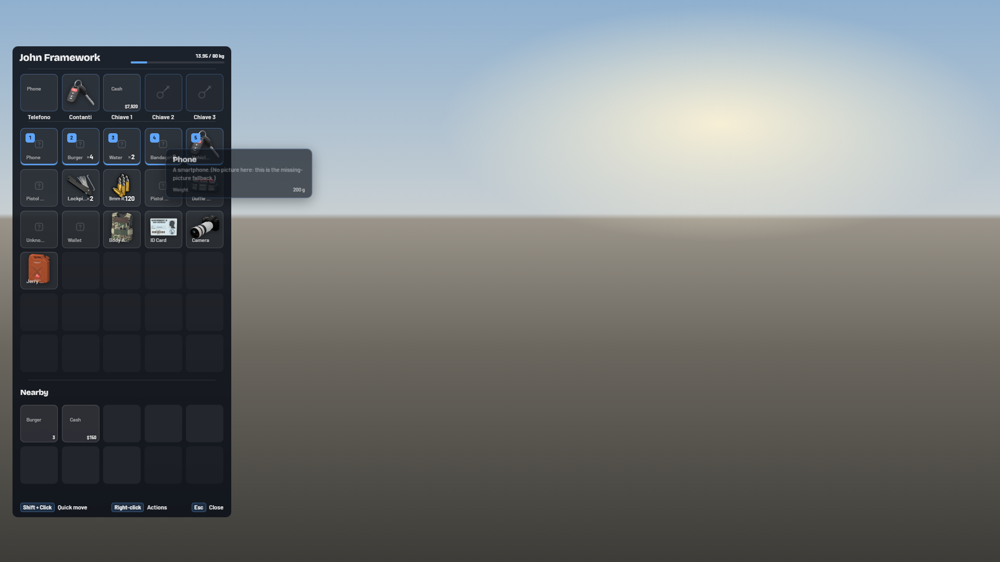
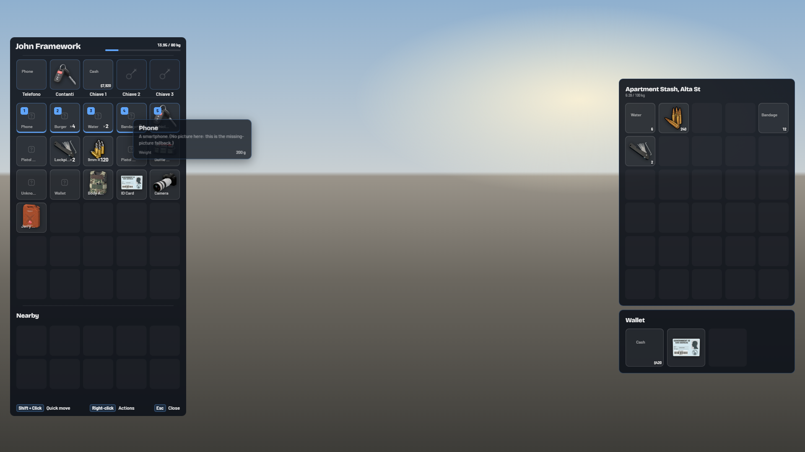

# whip_inventory_compact — "Dos columnas gemelas"

Skin para el inventario de WHIP. **No sustituye al renderer**: `whip_core` sigue dibujando slots,
arrastrar y soltar, tooltips, menús, pesos y la validación del servidor. Este recurso solo añade un
`theme.css`, un pequeño `client.lua` que elimina el desenfoque del juego y un selector de idioma
de una sola línea.

Consulta [README.md](README.md) para la documentación completa en inglés y las verificaciones.

## Características

- Dos columnas iguales de 420px a 1080p, margen de 24px y centro de la pantalla libre.
- Izquierda: título unido, 5 slots de accesorios nativos, cuadrícula del jugador, Nearby y teclas.
- Derecha: bolsas, maletero y cartera apilados verticalmente, sin superposiciones.
- 5 columnas por cuadrícula, slots de 72px, sin desenfoque ni oscurecimiento.
- Apertura/cierre animados, aparición animada de paneles, tooltip con retardo que no sale de la pantalla.
- La barra rápida de Tab usa el mismo estilo y permanece visible 2 segundos tras soltar la tecla.

## Idiomas (IT / EN / ES / FR / DE)

Cambia una línea en `config.lua` y ejecuta `restart whip_inventory_compact`:

```lua
Config.Locale = 'es' -- it, en, es, fr, de
```

`server.lua` compila las etiquetas elegidas en `locales/active.css`, importado por `theme.css`.
El fallback es `en` → `it` → nombre de la clave, igual que en `whip_clothingwheel`. Solo se traducen
las 5 etiquetas de accesorios y los mensajes de consola de este recurso: el resto de textos
pertenecen a `whip_core` y no puede cambiarlos un tema CSS.

## Instalación

La carpeta puede estar en **cualquier directorio bajo `resources/`** (`[custom]`, `[core]`, la
raíz de `resources/` u otra categoría). Solo importan el nombre de la carpeta y la dependencia de
`whip_core`:

```
resources/<cualquier-carpeta>/whip_inventory_compact/
```

Añade `ensure whip_inventory_compact` a `server.cfg`, o iníciala desde txAdmin. Requiere
`whip_core`. No hace falta editar archivos existentes del servidor.

| Comando | Efecto |
|---|---|
| `restart whip_inventory_compact` | recarga el CSS, regenera el idioma y aplica la skin a todos |
| `stop whip_inventory_compact` | vuelve al aspecto original de WHIP |
| `/whip_theme whip_inventory_compact` | reaplica el CSS solo para ti (requiere `whip.devtools`) |

## Paquete para GitHub

`LICENSE` MIT, `.gitignore`, `CHANGELOG.md` y capturas en `docs/screenshots/`. Versión `1.2.0`.
Publicado en https://github.com/OkanFeNwa/whip_inventory_compact (rama `main`); el manifest ya incluye el campo `repository`.




