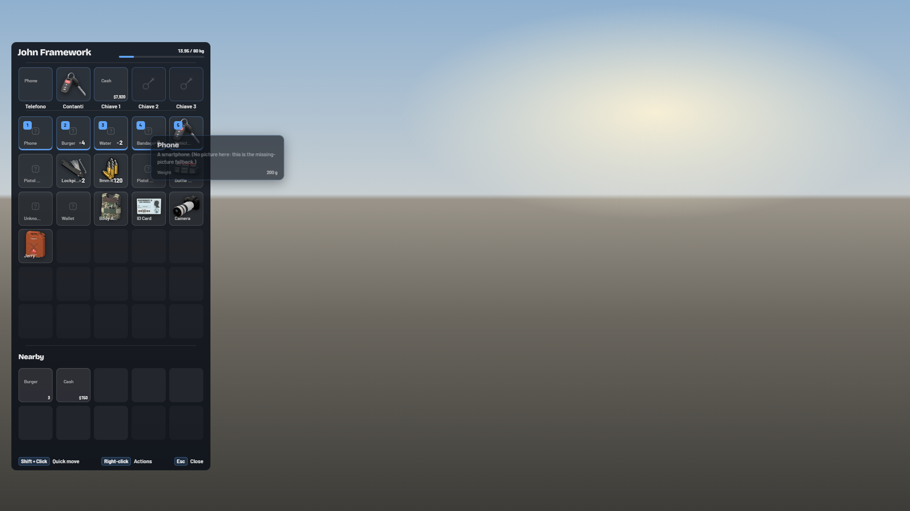
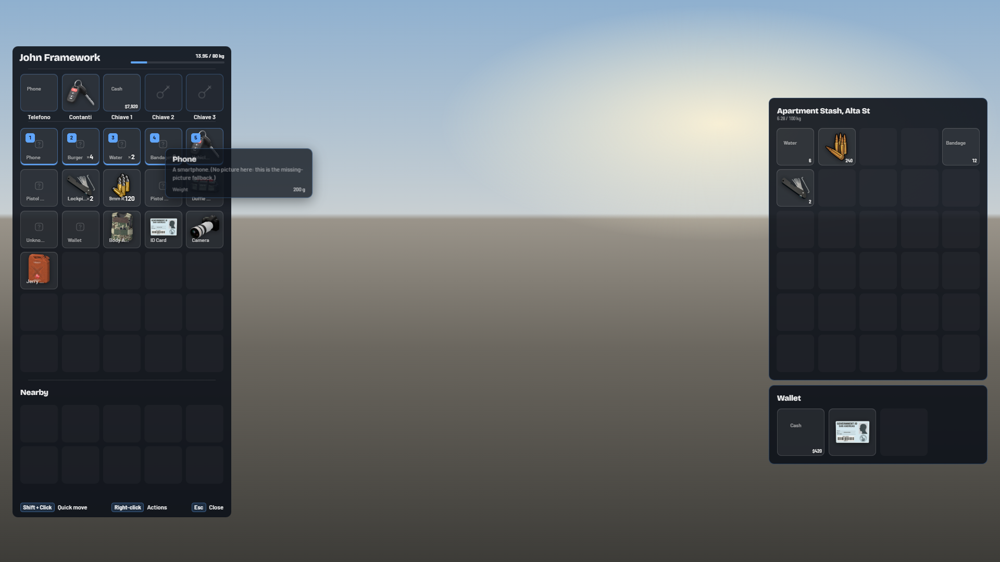

# whip_inventory_compact — "Deux colonnes jumelles"

Skin pour l'inventaire de WHIP. Il **ne remplace pas le renderer** : `whip_core` dessine toujours
les slots, le glisser-déposer, les infobulles, les menus, les poids et la validation serveur. Cette
ressource ajoute seulement un `theme.css`, un petit `client.lua` qui annule le flou du jeu et un
sélecteur de langue en une ligne.

Voir [README.md](README.md) pour la documentation complète en anglais et les vérifications.

## Fonctionnalités

- Deux colonnes égales de 420px en 1080p, marge de 24px, centre de l'écran libre.
- À gauche : titre attaché, 5 slots d'accessoires natifs, grille du joueur, Nearby et touches.
- À droite : sacs, coffre et portefeuille empilés verticalement, sans chevauchement.
- 5 colonnes par grille, slots de 72px, aucun flou ni assombrissement.
- Ouverture/fermeture animées, apparition animée des panneaux, infobulle différée qui ne sort pas
  de l'écran.
- La barre rapide de Tab reprend le même style et reste visible 2 secondes après le relâchement.

## Langues (IT / EN / ES / FR / DE)

Modifiez une seule ligne dans `config.lua`, puis lancez `restart whip_inventory_compact` :

```lua
Config.Locale = 'fr' -- it, en, es, fr, de
```

`server.lua` compile les libellés choisis dans `locales/active.css`, importé par `theme.css`.
Le repli est `en` → `it` → nom de la clé, comme dans `whip_clothingwheel`. Seuls les 5 libellés
d'accessoires et les messages console de cette ressource sont traduits : les autres textes
appartiennent à `whip_core` et un thème CSS ne peut pas les modifier.

## Installation

Le dossier peut se trouver dans **n'importe quel répertoire sous `resources/`** (`[custom]`,
`[core]`, la racine de `resources/` ou une autre catégorie). Seuls le nom du dossier et la
dépendance envers `whip_core` comptent :

```
resources/<n-importe-quel-dossier>/whip_inventory_compact/
```

Ajoutez `ensure whip_inventory_compact` à `server.cfg`, ou démarrez-le depuis txAdmin.
`whip_core` est requis. Aucun fichier existant du serveur n'est à modifier.

| Commande | Effet |
|---|---|
| `restart whip_inventory_compact` | recharge le CSS, régénère la langue et applique le skin à tous |
| `stop whip_inventory_compact` | restaure l'apparence d'origine de WHIP |
| `/whip_theme whip_inventory_compact` | réapplique le CSS pour vous seul (nécessite `whip.devtools`) |

## Paquet GitHub

`LICENSE` MIT, `.gitignore`, `CHANGELOG.md` et captures dans `docs/screenshots/`. Version `1.2.0`.
Publié sur https://github.com/OkanFeNwa/whip_inventory_compact (branche `main`) ; le manifest contient déjà le champ `repository`.




