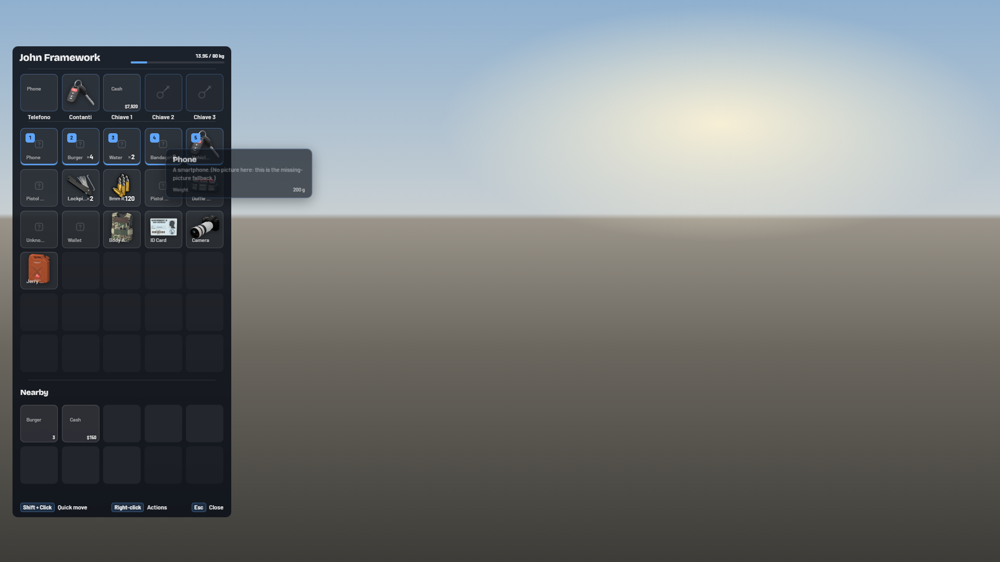
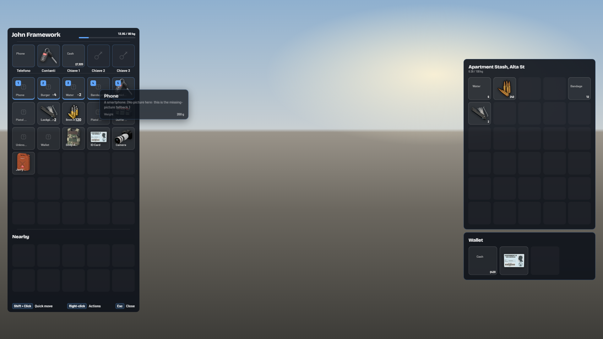

# whip_inventory_compact — "Tall Twin Columns"

A skin for WHIP's inventory. It **does not replace the renderer**: `whip_core` still draws every
slot, drag & drop, tooltips, menus, weights and server-side validation. This resource only adds a
`theme.css` (applied to everyone through `SetActiveTheme`) and a small `client.lua` that cancels
the game blur while the inventory is open. No existing server file has been modified.

GitHub-ready package: MIT licence, changelog, screenshots and **5 languages** (IT, EN, ES, FR, DE)
with the same one-line switch used by `whip_clothingwheel`.

Documentation: [Italiano](README.it.md) · [English](README.md) · [Español](README.es.md) ·
[Français](README.fr.md) · [Deutsch](README.de.md)

## What it does

- **Two columns of equal width (420px on screen at 1080p)**, with a minimum 24px gutter at the
  sides and 20px at the top and bottom; the whole layout is vertically centred.
  - On the left, **one single continuous card** with no breaks: the player name and weight
    capacity at the top (the native 14px margin was removed, so it is attached to the rest), then
    the 5 accessory slots (Phone, Cash, 3 keys) as large as the inventory slots, a divider, the
    player grid with quick slots 1–5 highlighted, a divider, the **Ground / Nearby** area on 2 rows
    and, at the bottom, the **key hints**. The dividers are **short 1px lines, centred and inset
    40px on each side** (480px internal over a 560px card): no outline around the window, only
    above and below.
  - On the right, the windows WHIP opens for bags, trunk, boot or wallet are **stacked vertically**
    (container + wallet, for example) instead of overlapping, **vertically centred as a group**
    both with one and with several containers open, with the first one opened on top (it is the
    first child in WHIP's DOM). They are as tall as their content, with no empty space. No
    dragging: this is CSS only.
- **Every grid has 5 columns per row**, with square slots of 72px on screen.
- The **centre of the screen stays free**.
- **Heavy shadows between panels were removed**: only thin, flat borders remain.
- **Animated opening and closing**: the window rises by 10px and settles in 0.26s.
  Everything arrives **together**: the native 0.07s delay on the accessory bar was removed, so
  phone/cash/keys no longer lag behind the inventory but enter with it as a single block. Closing
  is genuinely animated with `ease-in` over 0.24s (WHIP keeps `.open` for 250ms).
  **No flicker**: (1) the overlay no longer fades together with the window — it snaps to opacity 1
  and the only fade is the shell's; (2) `scale()` was removed: on an element with `zoom:0.75` it
  redrew slots and text at fractional pixels; (3) the easing is `--skin-ease`
  (`cubic-bezier(.25,.8,.25,1)`) instead of WHIP's `--ui-ease`, which performed 60% of the movement
  in the first frame.
- **No screen dimming**: `#inv-wash` is forced to `background: transparent` (it also beats the
  inline colour written by `inventory.js`), verified with `getComputedStyle`.
- **Animated container arrival**: bag / trunk / wallet panels enter with `skinPanelIn` (0.26s,
  rising 8px and settling, with no `scale`), even when opened while the inventory is already
  visible.
- The **item tooltip is larger**: 285×96px on screen instead of 225×80px, with 20/15/13px
  internal text. It has an **animated appearance with a 0.32s delay**: if the mouse passes quickly
  over an item it does not appear; it shows up only after a moment of hovering, with a slight lift.
  The animation sits on the inner `.inv-pop`, so the `left/top` coordinates written by
  `positionTooltip()` stay intact. The translation `transform` was **removed**: previously it
  moved the card by `-50%/-100%` *after* the native clamps, so an item near the left or top edge
  pushed it off screen. Now WHIP's clamps (which read the card after the theme resize) work again
  on all four sides.
- The **Tab hotbar** uses the same visual language as the inventory: solid dark surface, thin white
  lines, 14px radius like the panels, no shadow and no blue accent. Only the active state changes
  (lighter border/key). After Tab is released it **stays visible for at least 2 seconds** (2s hold
  + 0.2s fade): WHIP hides it immediately on keyup, so the delay is on the resting state
  transition, while the appearance stays immediate. This also applies when the segment is merged
  into the hint bar. Behaviour (1–5, counts, active slot) remains WHIP's.
- **Readable names and labels**: WHIP reserved 82px of the slot's 96px internal width for the
  counter, leaving 14px for the name (a single letter). The name now uses all the space up to the
  counter and longer strings fall back to ellipsis. The Phone / Cash / Key 1–3 labels went from
  10px to 15px internal, at full `var(--ui-text)` colour with a dark outline; the **key hints**
  went from 11px to 15px, with 14px keycaps.
- Reduced zoom (`--ui-zoom-inventory: 1` instead of 1.32): much less "fullscreen".
- **No background blur**: WHIP calls `TriggerScreenblurFadeIn(200)` on open
  (`whip_core/client/inventory.lua:1062`); being a FiveM native and not CSS, `theme.css` cannot
  cancel it. Our `client.lua` does: it registers on the same net events WHIP uses to open the
  inventory (our handlers run right after its own, in the same tick, so not even one frame is
  visible) and, in the meantime, checks the public export `exports.whip_core:IsInventoryOpen()`
  (line 2724) every frame for local opens (F2 with cache, radial, pad). It calls
  `TriggerScreenblurFadeOut(1)` only while the inventory is open. Other screens that use blur are
  untouched.

Note: by default WHIP hides "Nearby" when a container is opened (the inline `display:none` is
written by `setPanels`). The theme forces it to stay visible. Its boxes are drawn with a background
SVG that **copies exactly one empty native slot** (96px internal, 11px radius,
`rgba(255,255,255,.03)`, no visible border): they are therefore identical to the inventory slots
and are present even when WHIP renders no slots at all (`stash` scene with an empty Ground area).
When native slots exist, they line up exactly on top.

Note on the "bottom tooltips": they were read as **key hints** (the only fixed bar WHIP draws),
placed at the bottom of the left card and merged with it. In this version they are also larger
(15px internal text, 14px keycaps), so they are readable without leaning into the screen. The item
tooltip remains anchored to the cursor but, no longer translated, it cannot leave the edges.

## Installation

The folder can live in **any directory under `resources/`** — `[custom]`, `[core]`, directly in
`resources/`, or another category. Only the folder name and the `whip_core` dependency matter:

```
resources/<any-folder>/whip_inventory_compact/
```

Start the resource in either of two ways:

- add `ensure whip_inventory_compact` to `server.cfg`; **or**
- start it from txAdmin → Resources → Start.

At startup the resource applies the theme to everyone already connected. There is no need to edit
`whip_core/config.lua` or set any convars.

## Languages (IT / EN / ES / FR / DE)

As in the clothingwheel, the language is chosen from **one single line** in `config.lua`:

```lua
Config.Locale = 'it' -- it, en, es, fr, de
```

After changing it, run `restart whip_inventory_compact`: `server.lua` recompiles
`locales/active.css` from the `Config.Locales` labels and `theme.css` imports it as its first rule.
The client does not read Lua, so this is the bridge between config and CSS. The generated file is
committed with Italian values: if the server cannot write it, the skin stays in Italian and prints
a console warning instead of breaking.

| Code | Language | Phone | Cash | Keys |
|---|---|---|---|---|
| `it` | Italian | Telefono | Contanti | Chiave 1/2/3 |
| `en` | English | Phone | Cash | Key 1/2/3 |
| `es` | Español | Teléfono | Efectivo | Llave 1/2/3 |
| `fr` | Français | Téléphone | Argent | Clé 1/2/3 |
| `de` | Deutsch | Telefon | Bargeld | Schlüssel 1/2/3 |

`shared/locale.lua` uses the same logic as the clothingwheel: dot-path lookup (`accessory.phone`),
fallback `en` → `it` → key name, and `string.format` placeholders for console messages. Only the
five accessory labels and this resource's console messages are translated. The rest of the
inventory text (Nearby, key hints, item names) is drawn by `whip_core` and stays in its own
language: it cannot be changed by a CSS theme without rewriting the renderer.

## Useful commands

| Command | Effect |
|---|---|
| `start whip_inventory_compact` | applies the skin to **everyone** connected (and to players who join later) |
| `restart whip_inventory_compact` | reloads `theme.css` and regenerates `locales/active.css` from `config.lua` for **everyone** |
| `stop whip_inventory_compact` | removes the override and restores WHIP's stock look |
| `/whip_theme whip_inventory_compact` | reapplies the CSS link live **for you only** (needs `whip.devtools`) |
| `/whip_theme none` | removes the theme **for you only**, live |

### Who receives what

- **Edited `theme.css` on disk?** Nobody notices by themselves: the browser has already loaded the
  `<link>`. Use `restart whip_inventory_compact` for everyone, or `/whip_theme
  whip_inventory_compact` to try it just for yourself.
- Calling `SetActiveTheme` with the **same** name does nothing: the registry does not rebroadcast
  an identical value. That is why `restart` is the right command, not another `start`/`ensure`.
- `/whip_theme <resource>` is a **single-client** preview tool (see `server/devtools.lua`), not a
  global setting.

### Make it the default theme (without editing files)

1. `stop whip_inventory_compact` — while the override is active, it wins.
2. In game open `/whip` → **Settings** → **Theme** → `whip_inventory_compact`.

WHIP saves the value to file and `Settings.onChange('Theme')` applies it immediately to everyone;
from then on it is the fixed theme, also for new joiners, and the resource no longer needs to stay
started as an override. The classic alternative is to change `Config.Theme` in
`whip_core/config.lua` (line 1797, now `whip_inventory_compact`), but that requires a `whip_core`
restart.

## GitHub package

The folder is self-contained, contains no server or `whip_core` files, and is published at
**https://github.com/OkanFeNwa/whip_inventory_compact** (branch `main`).

```
whip_inventory_compact/
├── .gitattributes
├── .gitignore
├── LICENSE              MIT
├── README.md            English + links to the other 4 languages
├── README.it.md / README.es.md / README.fr.md / README.de.md
├── CHANGELOG.md
├── config.lua           language + labels
├── fxmanifest.lua
├── server.lua           generates locales/active.css and applies the theme
├── client.lua           cancels the native blur
├── theme.css            layout + import of the language CSS
├── shared/locale.lua    loader with fallback
├── locales/active.css   generated (default: Italian)
└── docs/screenshots/
    ├── pockets.png
    └── stash.png
```

`fxmanifest.lua` already contains the `repository` field with the URL above. `CHANGELOG.md` uses
SemVer: this release is `1.2.0`.





## Verification performed

Headless WHIP previews at 1920x1080 with the theme injected:

- screen margins: **24px on the left and 24px on the right** (1872px wrapper), 89px at the top and
  bottom;
- both columns are 420px wide on screen (560px internal × 0.75 zoom);
- left card **with no side borders** (verified: `border-left/right: 0` on title, accessories, grid,
  Nearby and key hints). Title (y=89, 44px high) **attached** to the accessories (y=133, 101px
  high), which in turn touch the inventory (y=234): zero gap. Then Ground (y=730), key hints
  (y=955);
- three 1px dividers, all using `background-image` with `background-size: 480px 1px` and centred
  `no-repeat` (below the title, below the accessories, above the Ground): short, inset lines, not
  an outline; name and weight verified ("John Framework 13.95 / 80 kg");
- accessory, player, Ground and container slots all 72×72px on screen (96px internal);
- 5 columns per row in every grid; Nearby 390×152px (5×2 boxes). Native empty slots and SVG-drawn
  ones have identical values: `rgba(255,255,255,.03)` background, transparent border, 11px radius
  (compared via `getComputedStyle`);
- no shadows on the panels;
- item tooltip: hovering a slot at (300,300) puts the box at x=316, y=284 (WHIP's inline
  `left/top`, without transform). Size **285×96px** (was 225×80px); name 20px, description 15px,
  rows 13px. All four edges were tested with `mousemove` to (20,300), (1900,300), (300,10),
  (300,1070): the box always stayed inside 1920×1080 (x=36, x=1599+285=1884, y=26,
  bottom=1072 respectively);
- animation: the exact `showOverlay()` sequence was traced frame by frame. The overlay snaps to
  `opacity:1` (no second fade) and the shell rises from `translateY(10px)` to 0 with opacity
  0.29 → 0.61 → 0.93 → 1 and y 94.2 → 91.7 → 89.3 → 88.8: a monotonic ramp, no jumps. No
  `scale()` (only `translate`), so no fractional pixels at `zoom:0.75`. Removing `.visible` keeps
  the closing animation. The accessory has `opacity:1`, `transform:none`, `transition:none` in both
  states: it arrives together with the rest;
- wash: with `.on` and the inline colour `rgba(10,12,18,.55)` written by JS, the computed value is
  `background: rgba(0,0,0,0)` → no dimming;
- container panel: `animation-name: skinPanelIn`, 0.26s duration (arrival verified);
- tooltip: 0.32s delay + 0.18s animation. Right after `.visible` and at +200ms the `.inv-pop` is at
  `opacity:0`, at +340ms it is 0.58, at +580ms it is 1 with an identity `transform`. The outer box
  has `transform: none` and `animation-name: none`, so WHIP's inline `left/top` are not altered;
- item names: the name "Phone" in a 72px slot is 27px wide on screen (formerly 9px, just the "P"),
  with `max-width: calc(100% - 42px)`. Accessory labels at 15px internal, full
  `var(--ui-text)` colour, and key hints at 15px / keycaps 14px (formerly 10px and 11px);
- languages: with Italian `locales/active.css` the accessory slots' `::after` returns
  `"Telefono"`, `"Contanti"`, `"Chiave 1"`…; replacing the file with EN and then ES values (with
  accents) changes the labels to `"Phone"/"Cash"/"Key 1"` and `"Teléfono"/"Efectivo"/"Llave 1"`,
  read via `getComputedStyle` — so the `@import` and UTF-8 variants work in WHIP's CEF;
- Tab hotbar: after `.visible` is removed, opacity stays **1 at 0 and at 1900ms**, is 0.28 at
  2050ms and 0 at 2200ms → fully visible for 2 seconds, then a 0.2s fade. Capsule with
  `rgba(13,18,26,.9)` background, `rgba(255,255,255,.1)` border, 14px radius, no shadow; keycaps
  with `rgba(255,255,255,.1)` background and the same border — no blue. Also applies to the
  segment inside the hints;
- `pockets` scene: left card as above, centre free;
- `stash` scene: container on the right (x=1476, y=188, 420×543) and wallet below it
  (x=1476, y=740, 420×152): the group is **vertically centred** (105px above and 106px below),
  with **zero overlaps** (checked with bounding boxes); Ground is still present on the left.
- The debug bar visible in the previews belongs to WHIP's preview tool (`#whip-preview-bar`): it
  does not exist in game and can be hidden with `F9` in the preview (it is removed in the
  screenshots).

For the blur, verification is on the source rather than the headless preview (which does not run
natives): `TriggerScreenblurFadeIn` / `FadeOut` at `inventory.lua:1062` / `:1358`, the three net
events that open the UI (`:1485`, `:1708`, `:1760`) and the `IsInventoryOpen` export at line 2724.
The one-frame flash was eliminated by registering our handlers on the same events: they run after
WHIP's because the resource declares `dependency 'whip_core'`. **Still to be confirmed in game**
with `restart whip_inventory_compact` (a restart is needed, not just a CSS reload).

## If something looks wrong

- The skin is fail-soft: if `theme.css` is not served, WHIP keeps its stock look and writes a note
  in the F8 console.
- Only two rules use `!important`, because they have to beat inline styles written by
  `inventory.js`: the `#inv-wash` colour and the `#inv-ground-panel` `display`. They target those
  elements only, not everything. The tooltip uses no `!important`: it leaves JS's `left`/`top`
  alone and only sets `transform: none` + `animation: none`, so WHIP's position clamps keep working.
- The columns are adjusted in `theme.css`, in the `.inv-wrapper` rule → `grid-template-columns`
  (values in "internal" pixels, then multiplied by WHIP's zoom). The card width is
  `--skin-card-w`, the slot size is `--skin-slot`, both at the top of the file.
- If you change `Config.Locale` but the labels do not change, check the F8 console message
  `[whip_inventory_compact] Active language: ...`. If there was a write error, the server cannot
  update `locales/active.css` (folder permissions): grant write access to the resource or edit
  `locales/active.css` by hand with the desired labels. In either case run `restart
  whip_inventory_compact`, not just `/whip_theme`.
